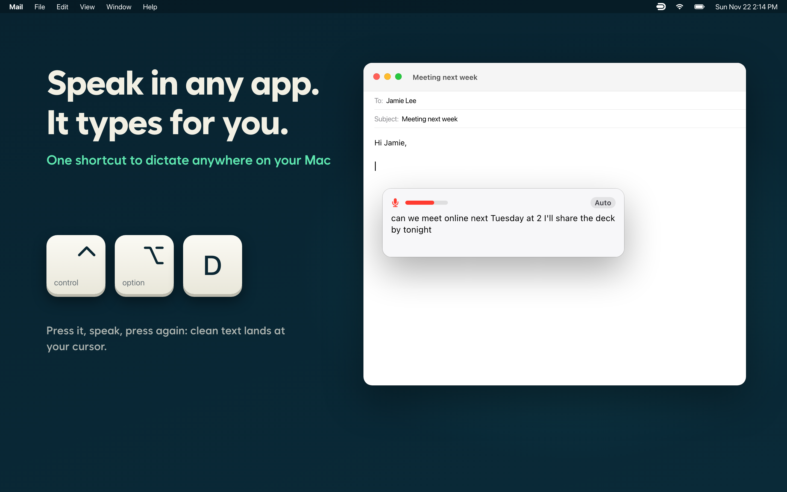
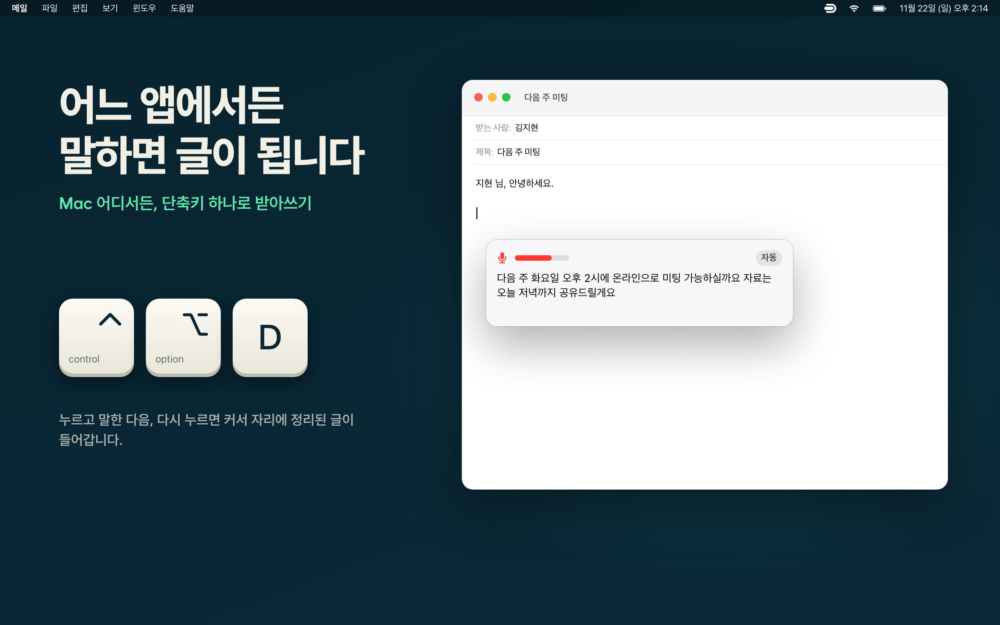

# QuickFill for Mac

Dictate into any app from the menu bar. Press a shortcut, speak, press it again, and the text is pasted where your cursor is, optionally cleaned up by AI. Your voice is recognized on your Mac and never leaves it.

**[Download QuickFill for Mac (DMG)](https://github.com/sungminoh/quickfill-releases/releases/latest/download/QuickFill.dmg)** · [All releases](https://github.com/sungminoh/quickfill-releases/releases)

Requires macOS 15 or later on an Apple silicon Mac.

## Install

1. Open `QuickFill.dmg` and drag QuickFill into Applications.
2. Open QuickFill. It lives in the menu bar. The setup window asks for the microphone, Accessibility, and optionally paste access: set QuickFill to **Always Allow** in System Settings › Privacy & Security, or macOS asks every time and QuickFill skips clipboard collection.
3. Download the recommended speech model (Whisper Large v3 Turbo). It is then prepared for your Mac's Neural Engine, which takes about two minutes once.

## Use

- **⌃⌥D**: click into any text field, press, speak, press again. Esc cancels.
- **⌃⌥V**: one panel for the clipboard, snippets, dictation history and AI actions on selected text.

Both shortcuts can be changed in Settings. With iCloud, QuickFill on your Mac and iPhone stay in sync.

## Updates

QuickFill doesn't update itself yet. New versions are posted on the [releases page](https://github.com/sungminoh/quickfill-releases/releases); download the DMG again and replace the app.

[Privacy policy](https://sungminoh.github.io/pages/quickfill/privacy/) · [Support](https://sungminoh.github.io/pages/quickfill/support/)

---

## 한국어

메뉴 막대에서 어느 앱에든 받아쓰기를 합니다. 단축키를 누르고 말한 다음 다시 누르면 커서 자리에 글이 들어가고, 원하면 AI가 다듬어 줍니다. 음성은 Mac 안에서 인식되고 밖으로 나가지 않습니다.

**[QuickFill for Mac 다운로드 (DMG)](https://github.com/sungminoh/quickfill-releases/releases/latest/download/QuickFill.dmg)**

Apple 실리콘 Mac, macOS 15 이상이 필요합니다.

1. `QuickFill.dmg`를 열고 QuickFill을 응용 프로그램 폴더로 끌어 놓습니다.
2. QuickFill을 엽니다(메뉴 막대에 있습니다). 시작 도우미에서 마이크, 손쉬운 사용, (선택) 붙여넣기 권한을 허용합니다. 붙여넣기는 시스템 설정 › 개인정보 보호 및 보안에서 **항상 허용**으로 두세요. 아니면 매번 묻고, 클립보드는 모으지 않습니다.
3. 추천 음성 모델(Whisper Large v3 Turbo)을 받습니다. 처음 한 번 이 Mac의 Neural Engine에 맞게 준비하는 데 2분쯤 걸립니다.

**⌃⌥D**로 받아쓰기, **⌃⌥V**로 클립보드·스니펫·기록·AI 패널을 엽니다. 단축키는 설정에서 바꿀 수 있습니다.

아직 자동 업데이트가 없습니다. 새 버전은 [릴리스 페이지](https://github.com/sungminoh/quickfill-releases/releases)에 올라오니, DMG를 다시 받아 앱을 바꿔 주세요.
